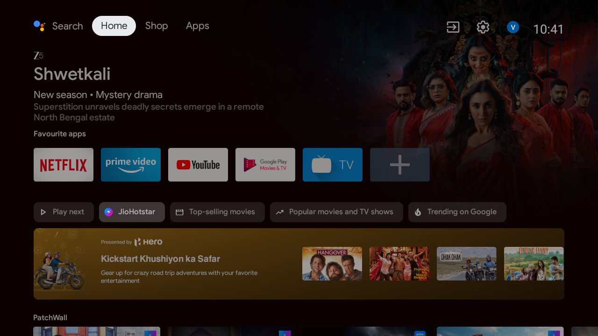
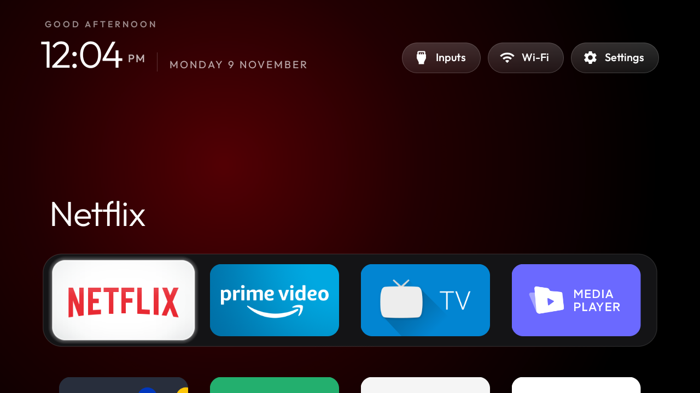

# Clean My TV Setup 🧹📺

How I cleaned up my **Xiaomi Android TV (Android 9)** over Wi-Fi with [CleanYourTV](https://github.com/Gathin23/CleanYourTV) — removed the ad/telemetry bloat and got an Apple TV-style home screen, with everything reversible.

> 🔒 Privacy note: exact TV model, IP addresses and backups are deliberately **not** in this repo. Replace `<TV_HOST>` with your TV's IP when you run the commands.

## What changed (before → after)

| | Before | After |
|---|---|---|
| Home screen | PatchWall with sponsored ads | Clean launcher (572 KB APK, no network permission) |
| Bloat / telemetry | 14 junk, ad, analytics packages running | Disabled (never uninstalled) |
| YouTube | Official app | [SmartTube](https://github.com/yuliskov/SmartTube) — no video ads, Shorts hidden, sponsor segments skipped |
| App-ads | — | AdGuard Private DNS (`dns.adguard-dns.com`) |
| Firmware updates | Auto | Off (re-enable to run one) |

| Before | After |
|---|---|
|  |  |

## What I disabled

The full list is in [`debloat-custom.txt`](debloat-custom.txt). Categories: Mi analytics, PatchWall content/ad services, Glance lock-screen, Mi TV+ sponsored channels, TV Manager cleaner, partner auto-installs, unused preloaded apps, firmware updater.

**Kept (personal choice):** voice assistant, Chromecast/Mi Cast/Miracast, Mi Music/Gallery, Play Store/Services, live TV & inputs — everything the TV needs to keep working.

## Commands (PowerShell on Windows)

```powershell
git clone https://github.com/Gathin23/CleanYourTV; cd CleanYourTV
python -m venv tools\venv
tools\venv\Scripts\pip install -r tools\requirements.txt

$env:TV_HOST = '<TV_HOST>'   # your TV's IP
powershell -ExecutionPolicy Bypass -File tools\disable.ps1 work\debloat-custom.txt  # debloat
```

## Launcher + remote-button remap

The launcher (`com.gathin.tvhome`, from the CleanYourTV repo) is built and installed with:

```powershell
powershell -ExecutionPolicy Bypass -File launcher\build-and-install.ps1 -InputKeyService -HomeKeyService
```

I edited `launcher/app/src/main/res/values/config.xml` (the only file CleanYourTV asks you to change) — see [`config-changes.md`](config-changes.md) for the exact diff:

- **Dock order** and which apps sit in it
- **app_keys**: remote YouTube button → SmartTube
- **settings_key_keycodes**: the Mi/PatchWall button now opens TV Settings (brightness lives there)

## Restore everything

```powershell
$env:TV_HOST = '<TV_HOST>'
powershell -ExecutionPolicy Bypass -File tools\restore.ps1 work\debloat-custom.txt
```

One-line un-disables when needed:

```
pm enable --user 0 <package>
```

And the extras: `settings put global private_dns_mode opportunistic` (AdGuard DNS off),
`pm enable --user 0 com.google.android.youtube.tv` (official YouTube back).

## Credits

- [CleanYourTV](https://github.com/Gathin23/CleanYourTV) by @Gathin23 — the debloat lists, the tools and the launcher (MIT). The debloat list here is adapted from the repo's tested list for this board family.
- [SmartTube](https://github.com/yuliskov/SmartTube) by @yuliskov.

## Licence

MIT — see [LICENSE](LICENSE).
